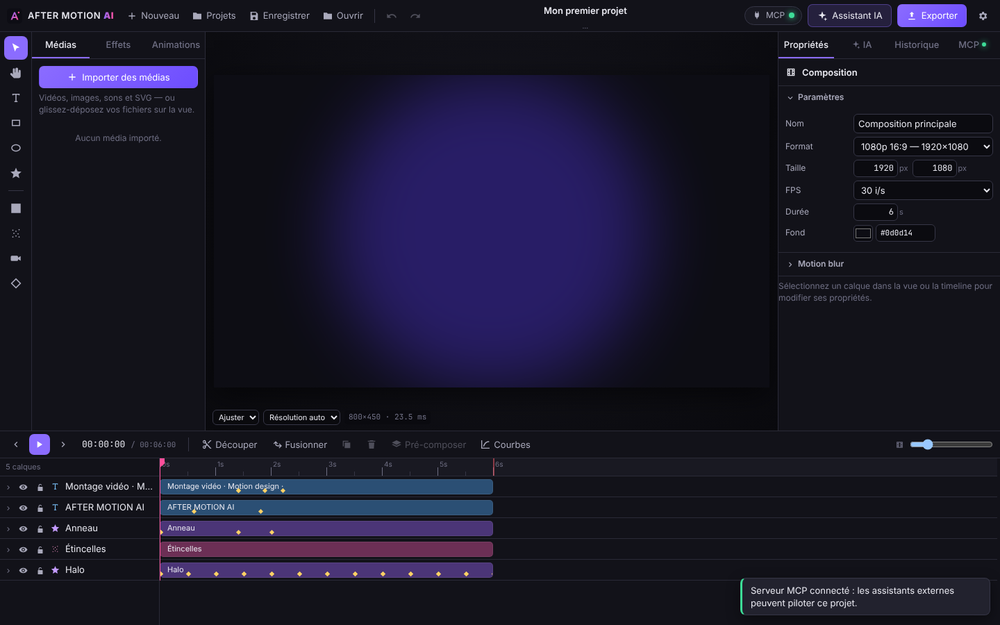

# AFTER MOTION AI

Éditeur vidéo et de motion design (dans l'esprit d'After Effects et d'Alight Motion) avec un
**assistant IA intégré** et un **serveur MCP** permettant à Claude et aux autres clients MCP de piloter
le projet réellement ouvert dans l'éditeur.

- Application web installable (**PWA**) : Chrome/Edge sur **Windows**, Chrome sur **Android**, et tout navigateur récent.
- Moteur de montage, moteur de rendu, IA et serveur MCP séparés en modules TypeScript.
- Interface sombre de type logiciel professionnel, adaptée aux petits écrans.



## Démarrage rapide

Prérequis : **Node.js ≥ 20** (22 recommandé) et un navigateur Chromium récent (Chrome, Edge, Android Chrome).

```bash
npm install
npm run build          # compile l'éditeur (apps/editor/dist) et le serveur MCP (packages/mcp-server/dist)
npm run mcp -- --no-stdio
# → ouvrir http://127.0.0.1:7823/  (l'éditeur s'appaire automatiquement au serveur MCP)
```

Développement de l'interface (rechargement à chaud) :

```bash
npm run dev            # http://127.0.0.1:5173/
```

Installer comme application : dans Chrome/Edge, menu ⋮ › *Installer AFTER MOTION AI* (Windows),
ou *Ajouter à l'écran d'accueil* (Android).

### Connecter Claude Desktop

```json
{
  "mcpServers": {
    "after-motion-ai": { "command": "node", "args": ["/chemin/absolu/packages/mcp-server/dist/index.js"] }
  }
}
```

Redémarrez Claude Desktop, ouvrez `http://127.0.0.1:7823/`, puis demandez par exemple :
*« Crée un titre "Bienvenue" qui apparaît avec un rebond, ajoute des particules, puis exporte en MP4. »*
Détails, options, liste des outils et sécurité : [docs/MCP.md](docs/MCP.md).

### Activer Claude dans l'assistant intégré

Paramètres ⚙ › Assistant IA › *Claude (API)* et saisissez votre clé API Anthropic (stockée
uniquement dans le navigateur). Sans clé, l'**assistant local hors-ligne** reste disponible.

## Fonctionnalités

| Domaine | Implémenté |
|---|---|
| **Projet** | Nouveaux projets (préréglages 16:9, 9:16, 1:1, 4:5, 4K), compositions multiples et imbriquées (pré-composition), résolution/FPS/durée/fond réglables |
| **Timeline** | Multipistes (un calque par piste), déplacement et rognage des clips avec magnétisme, découpe et fusion de clips, réordonnancement par glisser-déposer, visibilité/verrouillage/solo, keyframes visibles et déplaçables, zoom |
| **Calques** | Texte, formes (rectangle arrondi, ellipse, polygone, étoile, tracé SVG), solide, image, **SVG**, vidéo, audio, particules, caméra 2D, objet nul, composition ; parentage ; modes de fusion |
| **Transformations** | Position, échelle, rotation, opacité, point d'origine — à la souris/au doigt dans la vue (poignées) ou dans le panneau |
| **Animation** | Keyframes sur toutes les propriétés numériques et couleurs, chronomètre par propriété, **éditeur de courbes Bézier** + graphe de valeurs, 13 courbes prédéfinies (dont bounce, elastic, back), 23 presets (entrées, sorties, accentuation, texte lettre par lettre, logo, caméra) |
| **Motion design** | Texte animé (machine à écrire, fondu/montée/échelle par lettre, vague), tracés animés (trim paths), transitions (fondu, glissements, zoom, flou, volet, fondus enchaînés), particules déterministes (point/ligne/disque, gravité, couleurs, formes), caméra dynamique |
| **Effets** | Flou gaussien, **motion blur** (obturateur réglable), lueur (glow), ombre portée, luminosité/contraste, teinte/saturation, teinte couleur, noir & blanc, inversion, pixellisation, vignettage, tremblement — tous les paramètres sont animables ; registre extensible |
| **Masques** | Rectangle, ellipse, polygone ; ajouter/soustraire/intersection ; inversion ; contour progressif et opacité animables |
| **Médias** | Import vidéo/image/audio/SVG (bouton ou glisser-déposer), stockage local IndexedDB, lecture synchronisée avec le son, volume animable, vitesse |
| **Export** | **MP4 (H.264)** et **WebM (VP9/VP8)** via WebCodecs, audio mixé (AAC ou Opus selon le navigateur), choix résolution/FPS/qualité/plage, progression et annulation |
| **IA intégrée** | Instructions en langage naturel (FR/EN). Assistant local hors-ligne (plan présenté avant application) ou Claude (tool use sur le même catalogue d'outils que le MCP). Chaque réponse = une entrée d'historique annulable d'un clic |
| **Serveur MCP** | SDK officiel, stdio + Streamable HTTP, 41 outils, aperçu image, export écrit sur disque, autorisations dans l'éditeur, mode headless |
| **Fiabilité** | Annuler/rétablir illimité (historique visuel avec source Vous/IA/MCP), sauvegarde automatique, versions de récupération, reprise après fermeture inattendue, fichiers `.amai.json` (médias inclus) |
| **Performance** | Rendu à la demande, qualité adaptative pendant la lecture, résolution d'aperçu réglable, pool de canvas, médias en Blob (hors mémoire JS), libération des médias inutilisés |

## Tests

```bash
npm test               # 33 tests unitaires et d'intégration (moteur, IA, serveur MCP via le SDK client officiel)
npm run typecheck
npm run build && npm run test:e2e   # 21 tests de bout en bout dans Chromium (Playwright + ffmpeg requis)
```

Ce que couvrent les tests de bout en bout (`tests/e2e/run-e2e.mjs`), exécutés dans un vrai navigateur :
création de texte à l'outil, déplacement à la souris, assistant IA (rebond, particules, caméra,
optimisation) avec application et annulation, import vidéo+audio/PNG/SVG/WAV et vérification des
pixels rendus, masque + effets + motion blur, découpe/fusion, **export MP4 et WebM validés par
ffprobe** (codec, résolution, nombre d'images, durée, piste audio), client MCP → navigateur
(`create_text`, keyframes, effets, transitions, undo/redo, `get_preview`, autorisation refusée puis
accordée, `import_media` de fichier local, `export_video` écrit sur disque, `create_project`),
sauvegarde et **récupération après un vrai plantage de l'onglet**, interface mobile 390×844,
absence d'erreurs JavaScript.

## État actuel et limites (honnêtement)

- **Plateformes** : l'application est une PWA testée dans Chromium (Linux, desktop et viewport mobile).
  Il n'existe **pas encore de paquet natif** Android (APK) ni Windows (installeur) : l'installation
  passe par le navigateur. Voir [docs/PLATFORMS.md](docs/PLATFORMS.md) pour la feuille de route
  (Capacitor / Tauri). Safari/iOS n'a pas été testé (WebCodecs et `ctx.filter` y sont partiels).
- **Claude Desktop** : la connexion a été testée avec le **client officiel du SDK MCP** (même
  protocole stdio que Claude Desktop), pas avec l'application Claude Desktop elle-même.
- **Assistant Claude intégré** : la boucle d'outils est testée contre un serveur API simulé ;
  aucun appel réel à l'API Anthropic n'a été fait pendant le développement (pas de clé disponible).
- **Export** : dépend des encodeurs WebCodecs du navigateur. Dans le Chromium de test, H.264 est
  disponible mais pas AAC : les MP4 contiennent alors de l'audio **Opus** (lisible par VLC, Chrome,
  ffmpeg ; certains lecteurs anciens ne le lisent pas). Chrome/Edge sur Windows et Android
  fournissent généralement AAC.
- **Vidéo** : décodage via `<video>` (formats lus par le navigateur : MP4/H.264, WebM ; pas de ProRes,
  MOV dépend du système). L'export positionne la vidéo image par image : précis mais plus lent que
  le temps réel pour de longues vidéos.
- **Rendu** : Canvas 2D (pas encore de WebGL) ; les effets utilisent `ctx.filter`. 3D, tracking,
  détourage IA et éditeur de tracé à la plume ne sont pas implémentés.

## Structure

```
packages/core        Moteur : modèle, animation, easing, historique, API interne, outils, presets, effets
packages/renderer    Moteur de rendu Canvas 2D (effets, masques, motion blur, particules, caméra)
packages/ai          Connecteur IA : planificateur local, exécuteur de plans, agent Claude
packages/bridge      Protocole et client du pont éditeur ↔ serveur MCP
packages/mcp-server  Serveur MCP (stdio + HTTP), pont WebSocket sécurisé, mode headless
apps/editor          Interface React (Vite), médias, export, sauvegarde, PWA
tests/e2e            Tests de bout en bout (Playwright + ffprobe)
docs/                Architecture, MCP, plateformes
```

Architecture détaillée : [docs/ARCHITECTURE.md](docs/ARCHITECTURE.md).
